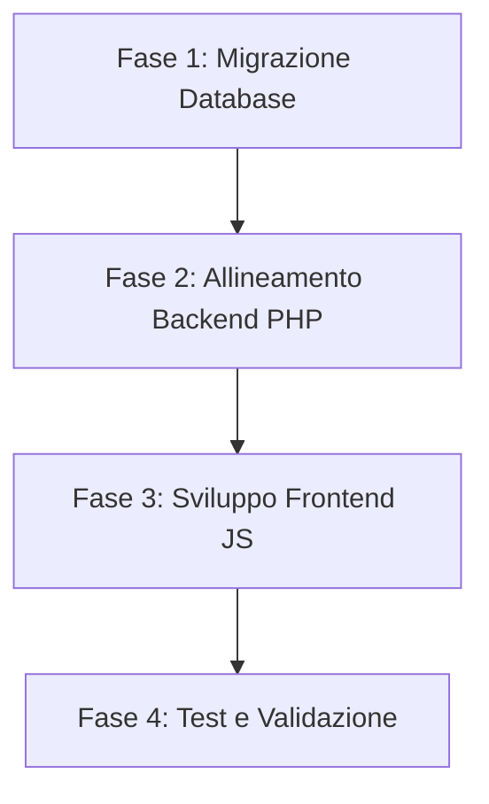

# Analisi di Dettaglio e Piano di Correzione: Gestione Multi-UoM e Listini Prezzi

Questo documento contiene lo studio approfondito dell'ERP Quack e definisce l'elenco esatto delle modifiche da apportare a database, backend e frontend per gestire la conversione dei prezzi, dei listini e delle quantità tra l'unità di misura (UoM) di Stock e la UoM Commerciale, garantendo integrità dei dati, flessibilità utente e conformità storica.

---

## 1. Analisi dei tuoi Appunti (Best Practice ERP)

I tuoi appunti sulle best practice ERP (SAP, Oracle, Dynamics) sono **eccellenti** e pongono le basi per un'architettura indistruttibile. 
Ecco la nostra valutazione sintetica:
*   **Voto: Ottimo e Completo per la parte concettuale.**
*   **Perché è buono**: Identifica il pilastro dell'**immutabilità transazionale** (snapshotting su riga documento) e il blocco delle modifiche all'unità di stock dopo i movimenti di magazzino.
*   **Cosa manca o va adattato per Quack**:
    1.  **Listini e RRP multi-UoM**: L'anagrafica dei listini vendita (`listini_prezzi`) e acquisto (`prodotti_fornitori_prezzi`) di Quack attualmente **non ha una colonna per la UoM**. I prezzi sono implicitamente riferiti solo all'unità di stock. Bisogna aggiungere la UoM nativa su queste tabelle.
    2.  **Snapshot del fattore**: Nelle righe d'ordine/preventivo, per congelare il fattore di conversione dobbiamo salvare `quantita_contenuto` al momento del salvataggio, evitando che future modifiche al packaging alterino i documenti del passato.
    3.  **Il Ciclo Acquisti completo**: La gestione deve valere sia per il Ciclo Vendite (Preventivi e Ordini Clienti) sia per il Ciclo Acquisti (Richieste di Offerta - RFQ, Ordini d'Acquisto, Ricevimento Merci).

---

## 2. Matrice delle Eccezioni e Casi Limite (Edge Cases)

| Scenario / Eccezione | Conseguenza sul Sistema | Soluzione Architetturale |
| :--- | :--- | :--- |
| **A. Cambio della Base UoM (Stock) prima dei movimenti** | Ci sono preventivi/ordini in bozza o aperti con la vecchia UoM. | Consentito se `giacenze` e `movimenti_magazzino` sono a 0. Tuttavia, il sistema deve aggiornare o ricalcolare le righe di preventivi/ordini in stato "bozza" per evitare disallineamenti di UoM. |
| **B. Cambio della Base UoM (Stock) dopo i movimenti** | Storico di magazzino corrotto, inventario incoerente. | **Blocco Totale a livello di codice (Controller/Model)**. Se esiste almeno un movimento di magazzino per il prodotto, il campo `unita_misura_stock_id` in modifica prodotto viene disabilitato in UI e rigettato in backend. |
| **C. Inserimento Listino/RRP in UoM Commerciale senza che il prodotto la abbia** | Divisione per zero o calcolo nullo. | In UI, se il prodotto non ha `unita_contenuto_id` impostato, la UoM selezionabile nel listino o nel prezzo consigliato (RRP) è bloccata solo sulla UoM di Stock. In backend, validazione rigida che rifiuta combinazioni non configurate. |
| **D. Eliminazione o Inattivazione di una UoM dal registro** | Prodotti o listini esistenti fanno riferimento a una UoM non più valida. | Si usa il **Soft-Delete** (`attivo = 0` su `unita_misura`). La UoM non compare più nei nuovi inserimenti, ma le transazioni passate e i prodotti esistenti continuano a funzionare normalmente. |
| **E. Variazione del fattore di conversione (`quantita_contenuto`)** | I preventivi passati o i listini storici potrebbero sballare. | I documenti salvati sono protetti perché usano lo **snapshot del fattore** salvato sulla riga. I listini prezzi esistenti rimangono in UoM commerciale, ma il loro valore equivalente in stock cambia (il backend applicherà il nuovo fattore per le nuove transazioni). |
| **F. Differenze di arrotondamento tra JS (float) e PHP (BCMath/round)** | Piccole discrepanze decimali (centesimi) sui totali riga. | Il frontend calcola i totali a scopo puramente visivo. Il backend esegue sempre il ricalcolo autoritativo prima del salvataggio nel database. |

---

## 3. Mappatura Esaustiva dei Cambiamenti Necessari

### A. Modifiche al Database (Schema SQL)

Per allineare Quack alle best practice, dobbiamo eseguire una migrazione del database SQLite/MySQL apportando le seguenti modifiche:

1.  **Tabella `listini_prezzi` (Vendita)**:
    *   Aggiungere colonna `unita_misura_id INTEGER REFERENCES unita_misura(id)` (consente di salvare il prezzo di listino riferito alla UoM commerciale o di stock).
2.  **Tabella `prodotti_fornitori_prezzi` (Acquisto)**:
    *   Aggiungere colonna `unita_misura_id INTEGER REFERENCES unita_misura(id)`.
3.  **Tabella `prodotti_fornitori` (RRP e Prezzi di default)**:
    *   Aggiungere colonna `rrp_unita_misura_id INTEGER REFERENCES unita_misura(id)` per indicare a quale UoM si riferiscono `rrp_min` e `rrp_max`.
4.  **Tabelle Transazionali (Righe Documenti)**:
    *   Nelle tabelle `preventivi_righe`, `ordini_clienti_righe`, `ordini_acquisto_righe`, `ricevimento_merce_righe`:
        *   Garantire la presenza di `quantita_stock` e `unita_misura_stock_id`.
        *   Aggiungere `quantita_contenuto_snapshot DECIMAL(10,3)` per memorizzare il fattore di conversione al momento della creazione del documento.

---

### B. Modifiche al Backend (PHP)

#### 1. Gestione Prodotti (`includes/prodotti.php` e `ProductsController.php`)
*   **Validazione Base UoM**: In `ProductsController@update`, controllare se esistono record in `movimenti_magazzino` per il prodotto. Se sì, impedire la modifica di `unita_misura_stock_id`.
*   **Salvataggio Listino Base**: Quando si crea/modifica un prodotto e si imposta il "Prezzo di vendita base", salvarlo nella tabella `listini_prezzi` associandogli esplicitamente la UoM di stock del prodotto.

#### 2. Calcolo Conversioni in Salvataggio Righe (`includes/sales_quotes.php`, `purchases_orders.php`, etc.)
*   Durante il salvataggio o modifica di un preventivo (`qk_insert_offerta` / `qk_update_offerta`):
    1.  Recuperare `quantita_contenuto` corrente del prodotto.
    2.  Salvare questo valore in `quantita_contenuto_snapshot` sulla riga.
    3.  Calcolare `quantita_stock` usando il fattore recuperato.
    4.  Salvare la UoM di stock del prodotto in `unita_misura_stock_id`.
*   Applicare la stessa logica speculare per gli ordini clienti, le RFQ, gli ordini d'acquisto e il ricevimento merci.

#### 3. Determinazione del Prezzo da Listino
*   Quando il backend (o il controller) ricerca il prezzo di listino per proporlo all'utente:
    1.  Cercare la riga di listino per il prodotto.
    2.  Se la UoM del listino corrisponde alla UoM selezionata dall'utente (es. KG), proporre il prezzo tal quale.
    3.  Se differisce, convertire il prezzo matematicamente:
        *   Se listino è in `KG` e l'utente ordina in `PZ` (e 1 PZ = 25 KG): $\text{Prezzo PZ} = \text{Prezzo KG} \times 25$.
        *   Se listino è in `PZ` e l'utente ordina in `KG`: $\text{Prezzo KG} = \text{Prezzo PZ} / 25$.

---

### C. Modifiche al Frontend (JavaScript e Viste)

#### 1. Libreria di Conversione Unificata (`assets/js/app.js`)
*   Migliorare `window.qkConvertUom` per accettare e gestire in modo pulito casi in cui la quantità contenuto non sia definita o sia pari a 1 (disabilitando la conversione).

#### 2. Maschere di Inserimento Documenti (`_form.php` dei preventivi e ordini)
*   **Selettore UoM dinamico**: Nelle righe del preventivo o ordine, il dropdown della UoM della riga deve contenere solo la UoM di Stock e la UoM Commerciale (se configurata).
*   **Allineamento campi**: Quando l'utente cambia la modalità di visualizzazione globale (Stock vs Commerciale):
    1.  Convertire sia la quantità inserita sia il prezzo unitario di ogni riga.
    2.  Aggiornare il testo della UoM della riga.
    3.  Ricalcolare il totale riga e i totali del documento.
*   **Visualizzazione RRP e Costi**: Mostrare il costo stimato e i range di RRP convertiti coerentemente con la modalità UoM attiva.

#### 3. Inserimento Listini Prezzi
*   Nelle maschere dei listini vendita e acquisto, aggiungere un menu a discesa per permettere all'utente di selezionare a quale UoM si riferisce il prezzo inserito (proponendo come default la UoM di stock del prodotto).

---

## 4. Piano di Azione e Correzione (Step-by-Step)

### Fase 1: Migrazione Database
1.  Creare uno script PHP (`db/migrate_pricelists_uom.php`) per aggiungere le colonne `unita_misura_id` su `listini_prezzi` e `prodotti_fornitori_prezzi`, valorizzandole inizialmente con la UoM di stock corrente di ogni prodotto (migrazione dati conservativa).
2.  Aggiungere le colonne `quantita_contenuto_snapshot` nelle righe delle tabelle transazionali.

### Fase 2: Backend PHP (Logiche e Helper)
1.  Modificare `includes/prodotti.php` per impedire la variazione della Base UoM se esistono movimenti di magazzino.
2.  Aggiornare `includes/sales_quotes.php`, `includes/purchases_rfq.php`, `includes/purchases_orders.php` per popolare le colonne snapshot e calcolare `quantita_stock` in modo matematicamente sicuro.

### Fase 3: Frontend e Interfaccia Utente
1.  Modificare le viste di creazione/modifica listini prezzi per permettere la selezione della UoM di prezzo.
2.  Aggiornare le viste dei preventivi e ordini per supportare il toggling dinamico delle UoM e mostrare i prezzi e costi convertiti on-the-fly.

### Fase 4: Validazione Finale
1.  Verificare che il magazzino registri sempre le movimentazioni in unità di Stock.
2.  Verificare l'immutabilità storica modificando un fattore di conversione su un prodotto e riaprendo un vecchio preventivo (deve mostrare i valori originari).
