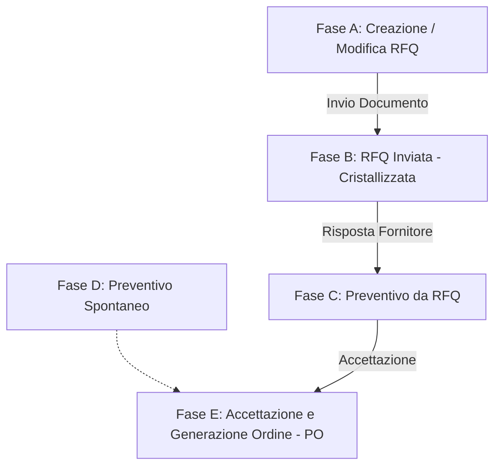

# Proposta Architetturale: Gestione Indirizzi di Consegna e Contatti Referenti nel Ciclo Acquisti

Questo documento definisce le linee guida, le logiche di database, backend e frontend/UI per la gestione degli indirizzi di spedizione e dei contatti referente all'interno delle varie fasi del ciclo acquisti di **Quack ERP**.

L'architettura si basa sul modello **"Snapshot & Override con Stato"**, che garantisce l'integrità dello storico dei documenti (cristallizzazione) senza sporcare l'anagrafica centralizzata e fornendo una chiara indicazione all'utente sullo stato dei dati.

---

## 1. Filosofia della Soluzione: "Snapshot & Override con Stato"

Per risolvere il problema della deriva dei dati (Master Data Drift), ogni tabella transazionale (`rfq_testata`, `offerte_testata`, `ordini_testata`) deve implementare le seguenti colonne:

1.  **ID di Riferimento (Foreign Key):** Puntatore all'anagrafica centralizzata (`indirizzo_consegna_id`, `contatto_id`).
2.  **Colonne Copiate (Snapshot / Testo Libero):** Colonne di tipo testo per memorizzare l'indirizzo e il referente così com'erano al momento del salvataggio (`consegna_via`, `consegna_citta`, `contatto_nome`, `contatto_email`, ecc.).
3.  **Flag di Stato (Boolean):** Colonne booleane (`consegna_is_override`, `contatto_is_override`) che indicano se il valore salvato sul documento è stato personalizzato manualmente dall'utente o se differisce dall'anagrafica a monte.

---

## 2. Fasi del Ciclo Acquisti e Comportamento Dettagliato

---

### FASE A: Creazione e Modifica Bozze RFQ

In questa fase, l'operatore imposta dove desidera ricevere la merce (indirizzo di consegna) e a quale referente del fornitore inviare la richiesta.

#### **Lato Database**
*   **Tabelle coinvolte:** `rfq_testata`.
*   **Campi coinvolti:** `indirizzo_consegna_id`, `consegna_via`, `consegna_civico`, `consegna_cap`, `consegna_citta`, `consegna_provincia`, `consegna_nazione`, `consegna_presso`, `consegna_referente`, `consegna_telefono`, `consegna_note`, `consegna_is_override`.
*   *Stessa struttura per la parte contatti:* `contatto_id`, `contatto_nome`, `contatto_telefono`, `contatto_email`, `contatto_is_override`.
*   **Stato di Cristallizzazione:** **Parziale (Non bloccato)**. I campi vengono compilati automaticamente alla selezione dell'ID, ma possono essere modificati liberamente finché la RFQ rimane in stato `bozza`.

#### **Lato Backend**
*   **Logica di Validazione:** Al salvataggio (`qk_rfq_save`), il backend confronta i testi ricevuti via POST con i record originali dell'indirizzo e del contatto.
    *   Se i testi inviati corrispondono esattamente all'anagrafica dell'ID selezionato, imposta `consegna_is_override = 0` (e/o `contatto_is_override = 0`).
    *   Se anche una sola lettera differisce (es. l'utente ha aggiunto "consegnare solo al mattino" nel campo via), imposta il flag a `1`.
    *   Se non è selezionato alcun ID (recapito manuale puro), il flag viene impostato a `1`.

#### **Lato Frontend / UI-UX**
*   **Editabilità:** I campi di testo dell'indirizzo e del referente sono **completamente editabili**.
*   **Elementi Visivi (UI):**
    *   Un menu a tendina (o autocompletamento) permette di scegliere la sede aziendale di consegna e il referente del fornitore.
    *   **Badge di Stato dinamici (gestiti in JS ad ogni input):**
        *   `✓ Sincronizzato con anagrafica` (colore verde) se i testi corrispondono al record dell'ID selezionato.
        *   `⚠️ Modificato localmente (override)` (colore giallo) se l'utente ha digitato una modifica manuale.
        *   `Recapito manuale / una tantum` (colore blu) se i campi sono popolati ma l'ID di riferimento è vuoto.
    *   **Azione:** Accanto al badge giallo compare un pulsante rosso **"Ripristina"** che, se cliccato, ripristina istantaneamente i testi originali dell'anagrafica, riportando lo stato a "Sincronizzato".

---

### FASE B: Invio Bozze RFQ

La RFQ viene inviata ufficialmente al fornitore (generazione del PDF/Word e cambio stato in `inviata`).

#### **Lato Database**
*   **Stato di Cristallizzazione:** **Totale (Blocco di Sicurezza)**. 
*   Non appena lo stato di `rfq_testata` diventa `inviata`, i dati di indirizzo, contatti, articoli e prezzi vengono **congelati storicamente**.

#### **Lato Backend**
*   Il controller blocca qualsiasi tentativo di richiesta `POST` volta a modificare una RFQ che si trova in uno stato diverso da `bozza` (lancia una `RuntimeException`). Questo garantisce che quanto stampato e inviato al fornitore corrisponda sempre a quanto memorizzato sul database dell'ERP.

#### **Lato Frontend / UI-UX**
*   **Editabilità:** Tutti i campi di testo dell'indirizzo, del referente e le selezioni degli ID sono **disabilitati (disabled / readonly)**.
*   **Elementi Visivi (UI):**
    *   I menu a tendina sono disabilitati.
    *   Viene mostrato il badge statico dello stato finale (es. `Sincronizzato` o `Modificato localmente`), ma il pulsante "Ripristina" e i campi di testo non sono interagibili.

---

### FASE C: Registrazione Preventivi da RFQ

Il fornitore risponde alla nostra RFQ inviandoci la sua offerta commerciale. L'operatore registra a sistema il preventivo collegandolo alla RFQ di origine.

#### **Lato Database**
*   **Tabelle coinvolte:** `offerte_testata` (collegata a `rfq_testata` tramite `rfq_id`).
*   **Gestione Indirizzo Consegna:** **Assente (Ereditato dinamico)**. La tabella `offerte_testata` non memorizza l'indirizzo di consegna. L'indirizzo visualizzato a schermo in sola lettura viene ricavato dinamicamente con un `LEFT JOIN` sulla tabella della RFQ originale (`rfq_testata.consegna_via`, ecc.).
*   **Gestione Contatti (Referente):** **Editabile locale**. La tabella `offerte_testata` possiede le colonne `contatto_id`, `contatto_nome`, `contatto_telefono`, `contatto_email` e `contatto_is_override`. Vengono inizialmente duplicate dai valori della RFQ ma possono essere modificate.

#### **Lato Backend**
*   Il controller popola il form prelevando i dati dalla RFQ collegata. 
*   In caso di salvataggio dell'offerta, verifica se il contatto commerciale del fornitore è stato modificato rispetto a quello originario della RFQ o dell'anagrafica del fornitore, salvando lo stato di override (`contatto_is_override = 1`).

#### **Lato Frontend / UI-UX**
*   **Editabilità Spedizione:** **Sola Lettura (Read-only)**. I campi dell'indirizzo di consegna sono visualizzati all'interno di un pannello grigio con input disabilitati.
    *   *Perché?* Un preventivo fornitore è una risposta commerciale. L'indirizzo di consegna è stato stabilito da noi nella RFQ e non può essere cambiato dal fornitore a piacimento sul preventivo. Mostrare l'indirizzo serve solo come contesto visivo per l'operatore.
*   **Editabilità Contatti:** **Editabile**. L'operatore può scegliere un referente commerciale diverso o aggiornare i recapiti (es. se l'offerta è firmata da un commerciale diverso da quello a cui avevamo inviato la RFQ).
    *   Mostra il badge di stato (`Modificato` / `Sincronizzato`) e il relativo pulsante "Ripristina" solo per il pannello del Referente.

---

### FASE D: Registrazione Preventivi Spontanei

Il fornitore ci invia un listino o un'offerta senza che noi l'avessimo esplicitamente richiesta con una RFQ. L'operatore registra un preventivo autonomo.

#### **Lato Database**
*   **Gestione Indirizzo Consegna:** **Assente**. Trattandosi di un preventivo spontaneo e non essendoci una RFQ, non ci sono dati di spedizione memorizzati sul preventivo.
*   **Gestione Contatti:** **Editabile locale** (tabella `offerte_testata`).

#### **Lato Backend**
*   Il backend non gestisce campi di indirizzo di consegna per questa fase. Inizializza i valori dei contatti a partire dall'anagrafica del fornitore selezionato.

#### **Lato Frontend / UI-UX**
*   **Pannello Spedizione:** Viene mostrato un avviso informativo chiaro:
    > ℹ️ **Preventivo spontaneo**
    > Non è associato ad alcuna RFQ di origine. L'indirizzo di destinazione merci verrà definito al momento della generazione dell'Ordine di Acquisto.
*   **Pannello Contatti:** Completamente editabile. L'utente seleziona il referente del fornitore tramite menu a tendina o lo inserisce manualmente (attivando il badge di override).

---

### FASE E: Accettazione e Generazione Ordine (PO)

L'operatore accetta il preventivo (da RFQ o Spontaneo) e genera l'Ordine d'Acquisto finale (`ordini_testata`).

#### **Lato Database**
*   **Tabelle coinvolte:** `ordini_testata`.
*   **Campi coinvolti:** `consegna_via`, `consegna_civico`, ..., `consegna_is_override`, `contatto_nome`, ..., `contatto_is_override`.
*   **Stato di Cristallizzazione:** **Inizialmente modificabile, bloccato all'invio dell'ordine**. L'indirizzo di consegna viene copiato nell'ordine. L'utente ha l'ultima possibilità di cambiarlo/correggerlo prima che l'ordine parta ufficialmente per la logistica.

#### **Lato Backend**
*   **Logica di Generazione:** 
    *   *Se da RFQ:* Il backend copia i campi `consegna_*` e `consegna_is_override` direttamente dalla RFQ originaria nella tabella `ordini_testata`.
    *   *Se da Preventivo Spontaneo:* L'ordine viene inizializzato con l'indirizzo della sede principale/magazzino dell'Azienda Interna impostata come acquirente.
*   **Verifica in fase di salvataggio/modifica Ordine:** Se l'utente decide di modificare la destinazione merce dell'ordine prima di inviarlo, il backend rivaluta `consegna_is_override` confrontando il testo inserito con la sede anagrafica selezionata per l'ordine.

#### **Lato Frontend / UI-UX**
*   **Pannello Spedizione & Contatti:** Entrambi i pannelli tornano ad essere **completamente editabili** (fino a quando l'ordine è in stato `bozza`).
    *   *Perché?* A livello di Ordine d'Acquisto (che è il documento definitivo inviato alla logistica), l'operatore deve poter forzare una destinazione merce differente per motivi logistici dell'ultimo minuto.
*   **Elementi Visivi:** 
    *   I controlli dell'indirizzo sono attivi.
    *   I badge di stato (`Sincronizzato` / `Modificato localmente` / `Manuale`) indicano se l'indirizzo dell'ordine corrisponde alla sede selezionata o se è stato personalizzato a mano.
    *   È presente il pulsante "Ripristina" per annullare l'override dell'indirizzo dell'ordine.

---

## 3. Matrice Riassuntiva dei Comportamenti

La seguente tabella riassume dove vengono salvati i dati fisici (testo) e chi ha i permessi di scrittura nelle varie fasi:

| Fase | Indirizzo di Consegna (Salvataggio Fisico) | Editabile? (Consegna) | Contatto Referente (Salvataggio Fisico) | Editabile? (Contatto) |
| :--- | :--- | :--- | :--- | :--- |
| **A: Bozza RFQ** | `rfq_testata` | **SÌ** (Con override & reset) | `rfq_testata` | **SÌ** (Con override & reset) |
| **B: RFQ Inviata** | `rfq_testata` (Cristallizzato) | **NO** (Sola lettura) | `rfq_testata` (Cristallizzato) | **NO** (Sola lettura) |
| **C: Prev. da RFQ** | *Nessuno* (Letto da `rfq_testata`) | **NO** (Sola lettura) | `offerte_testata` | **SÌ** (Con override & reset) |
| **D: Prev. Spontaneo**| *Nessuno* (Messaggio Info) | **NO** (Non applicabile) | `offerte_testata` | **SÌ** (Con override & reset) |
| **E: Ordine (Bozza)** | `ordini_testata` | **SÌ** (Con override & reset) | `ordini_testata` | **SÌ** (Con override & reset) |
| **E: Ordine (Inviato)**| `ordini_testata` (Cristallizzato) | **NO** (Sola lettura) | `ordini_testata` (Cristallizzato) | **NO** (Sola lettura) |
