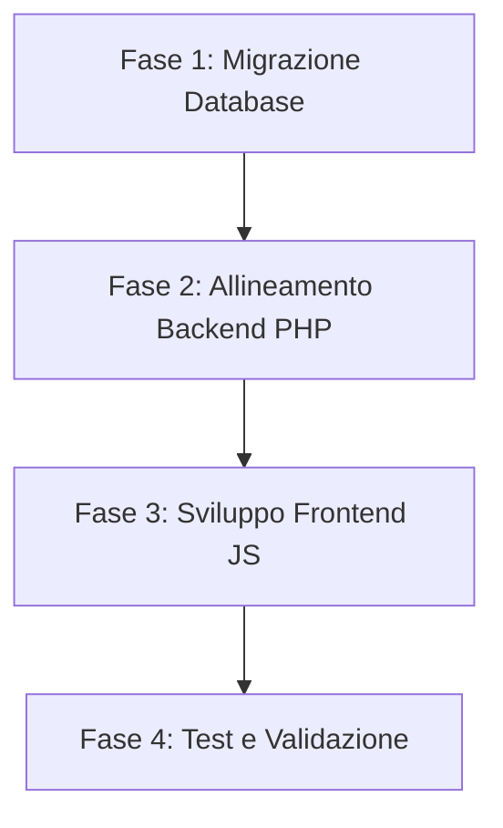

# Gestione Multi-UoM e Listini Prezzi - Manuale Architetturale e Tecnico Definitivo

Questo documento unifica e costituisce la specifica di riferimento definitiva per l'architettura Multi-UoM e la gestione dei listini prezzi nell'ERP Quack. Include l'intero contenuto dei tre documenti di analisi, specifica ed ereditarietà delle best practice.

---

## Fonti Utilizzate
Le informazioni e le specifiche contenute in questo documento sono state ricavate e considerate interamente dai seguenti file di progetto:
1. **Fonte 1**: `docs/Ciclo Vendite/Best Practice di ERP per Gestione multi UoM e Listini Prezzi.md`
2. **Fonte 2**: `docs/Ciclo Vendite/Analisi ed Elenco Correzioni Multi-UoM.md`
3. **Fonte 3**: `docs/Ciclo Vendite/Architettura Multi-UoM e Prezzi.md`

---

# PARTE 1: Best Practice di ERP per Gestione multi UoM e Listini Prezzi

## Focus: Industria Chimica (Acquisti, Magazzino, Vendite)

Questo documento analizza come i grandi ERP di fascia Enterprise (**SAP ERP**, **Oracle Cloud SCM** e **Microsoft Dynamics 365 F&O/Business Central**) affrontano la gestione delle unità di misura (UoM) multiple e dei prezzi a esse collegati, proponendo una soluzione tecnica ottimizzata per un'applicazione web sviluppata in PHP (Backend) e JavaScript (Frontend).

## 1. La Filosofia Cardine degli ERP Enterprise

Se si tenta di calcolare dinamicamente le quantità storiche e i prezzi basandosi *unicamente* sull'anagrafica prodotto corrente, l'ERP fallirà inevitabilmente al primo cambio di packaging o di densità.

I sistemi di classe mondiale si basano su tre pilastri architettonici:

### A. Immutabilità Transazionale (Transactional Snapshotting)

Quando un documento (preventivo, ordine di acquisto/vendita, fattura) viene salvato o finalizzato, **tutti i fattori di conversione, i prezzi unitari e le UoM utilizzate in quel momento vengono copiati (snapshottati) direttamente nelle righe del documento**.

*Se l'anagrafica prodotto cambia domani, i documenti passati rimangono matematicamente identici e intatti.*

### B. Il concetto di Base UoM (Stock UoM)

La **Base UoM** (chiamata in SAP *Base Unit of Measure - BUoM*) è l'unità di misura in cui viene tenuto il saldo di magazzino ed è immutabile una volta che sono avvenuti movimenti fisici. Tutte le transazioni in unità alternative (Commercial UoM / Sales UoM / Purchase UoM) vengono convertite e salvate *anche* nella Base UoM per aggiornare i saldi di inventario.

### C. Mantenimento delle UoM Native nei Listini (Native UoM Pricing)

I listini prezzi **non** vengono forzatamente convertiti in Base UoM all'interno del database dei listini. Se un fornitore vende un prodotto a `12.50 €/kg`, il listino memorizza esattamente `prezzo = 12.50`, `valuta = EUR`, `uom = KG`. La conversione in unità di stock avviene solo durante la transazione o la visualizzazione, memorizzando sia il prezzo inserito dall'utente sia il costo/prezzo di stock calcolato.

## 2. Come i Leader di Mercato Gestiscono le UoM

### SAP ERP (ECC & S/4HANA)

- **Tabelle Master (`MARM`)**: Gestisce le unità alternative inserendo coefficienti frazionari rispetto alla Base UoM. Per evitare errori di arrotondamento con numeri periodici (es. $1/3 = 0.33333333$), SAP memorizza un **Numeratore** e un **Denominatore** per ogni conversione.

- **Pricing Unit (`KPEIN`)**: SAP permette di definire i prezzi per "Quantità di Prezzo" (es. `150 € per 100 kg`). Questo risolve le problematiche legate a importi decimali microscopici per unità singola.

### Microsoft Dynamics 365

- **Classi di Conversione (Intra-class & Inter-class)**:
  
  - *Intra-class*: Conversioni standard fisse (es. da `g` a `kg` o da `L` a `mL`).
  
  - *Inter-class*: Conversioni specifiche per prodotto (es. da `L` a `kg` per un acido con densità $1.4 \text{ g/cm}^3$).

- **Catch Weight (Doppia Misura)**: Estremamente comune nel settore chimico/alimentare. Permette di tracciare contemporaneamente l'inventario in "Pezzi" (es. 5 fusti) e il peso reale effettivo (es. 1023 kg totali), fatturando sul peso effettivo rilevato al carico/scarico.

## 3. Matrice dei Casi Limite (Edge Cases) ed Eccezioni

Di seguito sono elencati tutti gli scenari critici indicati e le relative soluzioni adottate dai sistemi Best-in-Class.

| **Caso Limite / Eccezione**                                     | **Cosa succede nel DB / Sistema?**                                                                                                                                  | **Soluzione Best-Practice ERP**                                                                                                                                                                                                                                                                                                                                                                      |
| --------------------------------------------------------------- | ------------------------------------------------------------------------------------------------------------------------------------------------------------------- | ---------------------------------------------------------------------------------------------------------------------------------------------------------------------------------------------------------------------------------------------------------------------------------------------------------------------------------------------------------------------------------------------------- |
| **1. Cambio della UoM di Stock (Base UoM)**                     | Se modificata dopo che sono avvenuti movimenti, sballa tutto lo storico del magazzino e i costi medi ponderati.                                                     | **Divieto Assoluto.** Una volta che un prodotto ha movimenti di magazzino (anche solo 1), la Base UoM viene **bloccata**. Se è strettamente necessario cambiarla, l'utente deve azzerare lo stock del vecchio prodotto, disattivarlo e creare un *Nuovo Codice Prodotto*.                                                                                                                            |
| **2. UoM Commerciale mai inserita**                             | L'utente vuole inserire un preventivo o acquistare in un'unità alternativa, ma non è definita alcuna conversione.                                                   | Il sistema permette transazioni **solo** nella UoM di Stock. Sulla UI del preventivo/ordine, il selettore della UoM mostrerà unicamente l'unità di Stock di default.                                                                                                                                                                                                                                 |
| **3. UoM Commerciale aggiunta in un secondo momento**           | L'anagrafica viene aggiornata introducendo la possibilità di vendere a KG o Litri.                                                                                  | Nessun impatto retroattivo. I nuovi documenti beneficeranno della conversione, mentre quelli vecchi continueranno a fare riferimento alla UoM di Stock originariamente salvata sulle righe storiche.                                                                                                                                                                                                 |
| **4. Cambio del Fattore di Conversione**                        | Un fusto (unità stock) prima conteneva 25 kg di solvente, ora il fornitore lo confeziona da 20 kg.                                                                  | I documenti storici rimangono congelati (usano il fattore $25$ salvato sulle righe). Per l'anagrafica futura, ci sono due approcci:  <br>1) *Semplice*: Si modifica il fattore a $20$ in anagrafica (valido solo per i nuovi documenti).  <br>2) *Enterprise*: Si usa il **Versionamento dei fattori di conversione** con date di validità (es. Fattore = 25 fino al 31/12, Fattore = 20 dal 01/01). |
| **5. Eliminazione di una UoM dal catalogo globale**             | L'utente cancella la UoM "KG" o "LITRI" dall'anagrafica generale delle misure.                                                                                      | **Soft-Delete / Inattivazione.** Non si elimina fisicamente la riga dal DB se è referenziata altrove. Si imposta una colonna `is_active = FALSE`. Le transazioni in corso o storiche continuano a funzionare, ma non è più possibile selezionare quella UoM per nuovi prodotti o documenti.                                                                                                          |
| **6. Discrepanze da Arrotondamento (il problema di `0.33333`)** | Acquistando 1 fusto da 3 kg (unità stock), l'utente inserisce un ordine per 1 kg (0.3333 fusti). Lo stock finale calcola `3 * 0.3333 = 0.9999` fusti invece di `1`. | **Uso dei Coefficienti Frazionari (Numeratore/Denominatore)** invece di un singolo valore float. Nel database si salva che `1 KG = 1/3 di Fusto` (Numeratore: 1, Denominatore: 3). Il calcolo a database viene eseguito usando moltiplicazioni e divisioni intere o ad alta precisione (`DECIMAL(18,6)`).                                                                                            |

## 4. Architettura Database Proposta (MySQL/PostgreSQL)

Ecco lo schema relazionale ottimizzato per la tua applicazione in XAMPP. Nota come le tabelle transazionali (righe d'ordine) isolino completamente i dati storici.

```sql
-- 1. REGISTRO DELLE UNITÀ DI MISURA GLOBALE
CREATE TABLE uom_registry (
    uom_code VARCHAR(10) PRIMARY KEY, -- es. 'PZ', 'KG', 'L', 'FUSTO'
    uom_name VARCHAR(50) NOT NULL,
    uom_type ENUM('COUNT', 'WEIGHT', 'VOLUME') NOT NULL,
    is_active TINYINT(1) DEFAULT 1 NOT NULL,
    created_at TIMESTAMP DEFAULT CURRENT_TIMESTAMP
);

-- 2. ANAGRAFICA PRODOTTI
CREATE TABLE products (
    product_id INT AUTO_INCREMENT PRIMARY KEY,
    sku VARCHAR(50) UNIQUE NOT NULL,
    name VARCHAR(255) NOT NULL,
    stock_uom_code VARCHAR(10) NOT NULL, -- BASE UoM (Immutabile se ha movimenti di magazzino)
    is_active TINYINT(1) DEFAULT 1 NOT NULL,
    FOREIGN KEY (stock_uom_code) REFERENCES uom_registry(uom_code)
);

-- 3. FATTORI DI CONVERSIONE SPECIFICI PER PRODOTTO
-- Formula: 1 Unità Alternativa (alt_uom_code) = (num_factor / den_factor) * Unità di Stock
-- Esempio: 1 KG (alt) di Prodotto X = (1 / 25) * FUSTO (stock). Quindi 1 KG = 0.04 Fusti.
CREATE TABLE product_uom_conversions (
    product_id INT NOT NULL,
    alt_uom_code VARCHAR(10) NOT NULL,
    num_factor DECIMAL(18, 9) NOT NULL DEFAULT 1.000000000, -- Numeratore
    den_factor DECIMAL(18, 9) NOT NULL DEFAULT 1.000000000, -- Denominatore
    PRIMARY KEY (product_id, alt_uom_code),
    FOREIGN KEY (product_id) REFERENCES products(product_id) ON DELETE CASCADE,
    FOREIGN KEY (alt_uom_code) REFERENCES uom_registry(uom_code)
);

-- 4. LISTINI PREZZI (Acquisto, Vendita, RRP)
-- Conservano la UoM nativa inserita dall'utente commerciale.
CREATE TABLE price_lists (
    price_list_id INT AUTO_INCREMENT PRIMARY KEY,
    product_id INT NOT NULL,
    price_type ENUM('PURCHASE', 'SALES', 'RRP') NOT NULL,
    currency VARCHAR(3) NOT NULL DEFAULT 'EUR',
    price_value DECIMAL(18, 4) NOT NULL, -- Valore del prezzo
    price_uom_code VARCHAR(10) NOT NULL,  -- UoM inserita (può essere stock o commerciale)
    valid_from DATE NOT NULL,
    valid_to DATE,
    FOREIGN KEY (product_id) REFERENCES products(product_id),
    FOREIGN KEY (price_uom_code) REFERENCES uom_registry(uom_code)
);

-- 5. TRANSAZIONI: RIGHE ORDINE DI VENDITA (Esempio applicabile anche ad Acquisti/Preventivi)
-- Questa tabella CONGELA tutte le conversioni al momento del salvataggio del documento.
CREATE TABLE sales_order_lines (
    line_id INT AUTO_INCREMENT PRIMARY KEY,
    order_id INT NOT NULL,
    product_id INT NOT NULL,

    -- Dati inseriti dall'utente (Commerciali)
    ordered_qty DECIMAL(18, 4) NOT NULL,          -- es. 10.0000
    ordered_uom_code VARCHAR(10) NOT NULL,       -- es. 'KG'
    input_unit_price DECIMAL(18, 4) NOT NULL,     -- es. 12.5000 (prezzo al KG)

    -- Snapshot dei fattori di conversione attivi AL MOMENTO della transazione
    num_factor_snapshot DECIMAL(18, 9) NOT NULL,  -- Memorizza il numeratore attivo al salvataggio
    den_factor_snapshot DECIMAL(18, 9) NOT NULL,  -- Memorizza il denominatore attivo al salvataggio

    -- Dati calcolati per il Backend / Logistica (Riferiti sempre all'Unità di Stock)
    stock_qty DECIMAL(18, 4) NOT NULL,            -- Quantità in unità di stock (es. fusti) calcolata
    stock_uom_code_snapshot VARCHAR(10) NOT NULL, -- Unità di stock congelata
    system_unit_price_stock DECIMAL(18, 4) NOT NULL, -- Costo/prezzo unitario convertito in unità di stock

    row_total DECIMAL(18, 4) NOT NULL,            -- Totale riga (evita ricalcoli fluttuanti): ordered_qty * input_unit_price
    FOREIGN KEY (product_id) REFERENCES products(product_id)
);
```

## 5. Logica di Calcolo Matematico (Frazioni vs Floats)

Per garantire la massima precisione numerica ed evitare che `0.33333333` si perda nel database, definiamo la logica matematica di conversione.

### Formule di Conversione

Definiamo la relazione d'anagrafica come:

$$\text{1 Unità Commerciale (Alt)} = \left(\frac{\text{Numeratore}}{\text{Denominatore}}\right) \times \text{Unità di Stock (Base)}$$

#### Esempio:

- **Unità Stock**: `FUSTO`

- **Unità Commerciale**: `KG`

- Un fusto contiene **25 kg** di prodotto.

- Significa che $1 \text{ KG} = \frac{1}{25} \text{ Fusto}$.
  
  - `num_factor` = $1.000000000$  
  
  - `den_factor` = $25.000000000$  

#### Caso A: L'utente ordina $100 \text{ kg}$ (Unità Commerciale)

Vogliamo calcolare la quantità equivalente in **Unità Stock** per movimentare il magazzino:

$$\text{Quantità Stock} = \text{Quantità Commerciale} \times \left(\frac{\text{Numeratore}}{\text{Denominatore}}\right)$$

$$\text{Quantità Stock} = 100 \times \left(\frac{1}{25}\right) = 4 \text{ Fusti}$$

#### Caso B: L'utente inserisce un prezzo di listino di $15.00 \text{ €/KG}$

Vogliamo calcolare l'equivalente prezzo per **Unità Stock** (Fusto):

$$\text{Prezzo Stock} = \text{Prezzo Commerciale} \div \left(\frac{\text{Numeratore}}{\text{Denominatore}}\right) = \text{Prezzo Commerciale} \times \left(\frac{\text{Denominatore}}{\text{Numeratore}}\right)$$

$$\text{Prezzo Stock} = 15.00 \times \left(\frac{25}{1}\right) = 375.00 \text{ €/Fusto}$$

## 6. Implementazione Software (Backend PHP & Frontend JS)

Per garantire un'esperienza utente (UX) eccellente ed evitare bug di calcolo tra client e server, la conversione deve avvenire sia in JS (reattività UI) che in PHP (validazione e scrittura DB).

### A. Frontend: Logica JavaScript (`uom-converter.js`)

In JavaScript utilizziamo la libreria nativa `BigInt` o una precisione decimale accurata per evitare le fluttuazioni dei numeri a virgola mobile di JS (es. `0.1 + 0.2 = 0.30000000000000004`).

```javascript
class UomConverter {
    /**
     * Converte la quantità commerciale in quantità di stock
     * @param {number|string} commercialQty 
     * @param {number|string} num 
     * @param {number|string} den 
     * @returns {number}
     */
    static toStockQty(commercialQty, num, den) {
        const q = parseFloat(commercialQty);
        const n = parseFloat(num);
        const d = parseFloat(den);
        if (isNaN(q) || isNaN(n) || isNaN(d) || d === 0) return 0;

        // Calcolo ad alta precisione arrotondato a 4 decimali
        return parseFloat((q * (n / d)).toFixed(4));
    }

    /**
     * Converte il prezzo commerciale in prezzo riferito all'unità di stock
     * @param {number|string} commercialPrice 
     * @param {number|string} num 
     * @param {number|string} den 
     * @returns {number}
     */
    static toStockPrice(commercialPrice, num, den) {
        const p = parseFloat(commercialPrice);
        const n = parseFloat(num);
        const d = parseFloat(den);
        if (isNaN(p) || isNaN(n) || isNaN(d) || n === 0) return 0;

        return parseFloat((p * (d / n)).toFixed(4));
    }
}
```

### B. Backend: Validazione e Salvataggio PHP (`OrderProcessor.php`)

Il backend non si fida mai dei calcoli inviati dal frontend. Ricalcola tutto lato server e popola la tabella transazionale con i valori corretti e congelati.

```php
<?php

class OrderProcessor {
    private $db;

    public function __construct(PDO $dbConnection) {
        $this->db = $dbConnection;
    }

    public function saveOrderLine($orderId, $productId, $orderedQty, $orderedUom, $inputPrice) {
        // 1. Recupera i dati anagrafici correnti del prodotto e le conversioni
        $stmt = $this->db->prepare("
            SELECT p.stock_uom_code, c.num_factor, c.den_factor
            FROM products p
            LEFT JOIN product_uom_conversions c 
              ON p.product_id = c.product_id AND c.alt_uom_code = :ordered_uom
            WHERE p.product_id = :product_id
        ");
        $stmt->execute([
            ':product_id' => $productId,
            ':ordered_uom' => $orderedUom
        ]);
        $product = $stmt->fetch(PDO::FETCH_ASSOC);

        if (!$product) {
            throw new Exception("Prodotto non trovato o UoM non configurata.");
        }

        // Se l'utente ordina direttamente in unità di stock, i fattori sono 1/1
        if ($orderedUom === $product['stock_uom_code']) {
            $numFactor = 1.000000000;
            $denFactor = 1.000000000;
        } else {
            if (!$product['num_factor'] || !$product['den_factor']) {
                throw new Exception("Fattore di conversione mancante per la UoM selezionata.");
            }
            $numFactor = (float)$product['num_factor'];
            $denFactor = (float)$product['den_factor'];
        }

        // 2. Esegui i calcoli di conversione (Usando BCMath in PHP per evitare imprecisioni float)
        // Quantità Stock = Qty Ordinata * (Num / Den)
        $conversionRate = bcdiv($numFactor, $denFactor, 9);
        $stockQty = bcmul($orderedQty, $conversionRate, 4);

        // Prezzo Stock = Prezzo Ordinato * (Den / Num)
        $inverseRate = bcdiv($denFactor, $numFactor, 9);
        $stockPrice = bcmul($inputPrice, $inverseRate, 4);

        // Calcolo totale riga
        $rowTotal = bcmul($orderedQty, $inputPrice, 4);

        // 3. Persisti nel DB congelando lo snapshot
        $insertQuery = "
            INSERT INTO sales_order_lines (
                order_id, product_id, ordered_qty, ordered_uom_code, input_unit_price,
                num_factor_snapshot, den_factor_snapshot,
                stock_qty, stock_uom_code_snapshot, system_unit_price_stock, row_total
            ) VALUES (
                :order_id, :product_id, :ordered_qty, :ordered_uom, :input_price,
                :num_factor, :den_factor,
                :stock_qty, :stock_uom, :stock_price, :row_total
            )
        ";

        $insertStmt = $this->db->prepare($insertQuery);
        $insertStmt->execute([
            ':order_id'    => $orderId,
            ':product_id'  => $productId,
            ':ordered_qty' => $orderedQty,
            ':ordered_uom' => $orderedUom,
            ':input_price' => $inputPrice,
            ':num_factor'  => $numFactor,
            ':den_factor'  => $denFactor,
            ':stock_qty'   => $stockQty,
            ':stock_uom'   => $product['stock_uom_code'],
            ':stock_price' => $stockPrice,
            ':row_total'   => $rowTotal
        ]);

        return $this->db->lastInsertId();
    }
}
```

## 7. Flusso di Lavoro Esemplificato (Esempio Pratico)

Analizziamo il ciclo di vita completo del prodotto chimico **"Solvente Chimico Alpha"**.

### Fase 1: Configurazione Anagrafica

- **Prodotto**: Solvente Alpha (ID: 42)

- **UoM di Stock**: `FUSTO` (pezzi fisici in magazzino)

- **UoM Commerciale**: `KG`

- **Fattore di Conversione**: Un fusto contiene esattamente $25\text{ kg}$.
  
  - $1\text{ KG} = 1/25\text{ Fusto}$.
  
  - `num_factor` = $1$, `den_factor` = $25$  

### Fase 2: Configurazione Listini

L'utente inserisce due tipi di prezzi:

1. **Prezzo di Listino Vendita Commerciale**: `10.00 €/KG`

2. **Prezzo Consigliato (RRP) dal Fornitore**: `200.00 €/FUSTO` (in unità di stock)

Il database memorizza esattamente queste informazioni nativamente nella tabella `price_lists`.

### Fase 3: Redazione del Preventivo / Sales Order

Un cliente richiede un preventivo per **100 KG** di Solvente Alpha.

1. **Selezione Prodotto**: L'utente seleziona "Solvente Alpha".

2. **Selezione UoM**: L'interfaccia client (JS) vede che le unità disponibili sono `FUSTO` (Default) e `KG` (da tabella conversioni). L'utente seleziona `KG`.

3. **Determinazione del Prezzo sulla UI**:
   
   - Il sistema cerca il listino. Trova `10.00 €/KG`.
   
   - Poiché la UoM del listino corrisponde alla UoM selezionata (`KG`), propone direttamente `10.00 €/KG`.
   
   - *Se l'utente avesse selezionato `FUSTO`*, il JS avrebbe preso il prezzo del listino in KG (`10.00`), applicato la formula inversa di conversione ($10.00 \times 25 / 1$) mostrando all'utente `250.00 €/FUSTO`.

4. **Salvataggio Documento**:
   
   - Il backend riceve la riga: `Prodotto: 42, Quantità ordinata: 100, UoM: KG, Prezzo: 10.00`.
   
   - Il backend calcola i valori di magazzino:
     
     - Quantità Stock = $100 \times (1 / 25) = 4\text{ Fusti}$.
     
     - Prezzo unitario di Stock = $10.00 \times (25 / 1) = 250.00\text{ €/Fusto}$.
   
   - Scrive lo snapshot nella tabella `sales_order_lines`.

### Fase 4: Spedizione e Logistica

L'addetto al magazzino vede l'ordine di spedizione. Il sistema gli dice di prelevare **4 Fusti** (Stock UoM).

L'addetto effettua il prelievo. Il magazzino viene scaricato di 4 unità fisiche.

## Conclusioni e Raccomandazioni per lo Sviluppo

Seguendo questo schema architetturale:

1. **Il magazzino è al sicuro**: ragiona sempre e solo in un'unica valuta di stock fisicamente immutabile.

2. **I contratti sono storicamente corretti**: se il solvente chimico Alpha in futuro cambierà confezionamento passando a fusti da 20 kg, l'ordine emesso oggi continuerà a riportare che 100 kg equivalgono a 4 fusti da 25 kg, preservando la contabilità aziendale.

3. **L'inserimento dati è flessibile**: i colleghi commerciali possono negoziare in KG, Litri o Fusti senza che questo alteri i controlli fisici dell'inventario.

---

## 8. Log Decisioni e Specifica Implementativa Quack ERP (Giugno 2026)

Di seguito si riportano le decisioni concordate per l'allineamento del codice sorgente:

### A. Frazione di Conversione (Numeratore / Denominatore) a Database

**Decisione**: L'utente inserisce il valore di contenuto come decimale semplice (es. `25`, `12.5`, `0.75`). Il backend converte deterministicamente il decimale in coppia di interi numeratore/denominatore tramite potenze di 10, con riduzione al minimo comune denominatore (GCD):

*   `25` → num=`1`, den=`25`
*   `12.5` → 125/10 → GCD=5 → num=`1`, den=`2` (cioè 12.5 = 25/2, esatto)
*   `0.75` → 75/100 → GCD=25 → num=`3`, den=`4` (esatto)
*   `12.3` → 123/10 → GCD=1 → num=`123`, den=`10` (esatto)

Tutti i calcoli a database usano questa coppia intera, evitando la deriva tipica dei float (`1/3 = 0.33333...`). Il frontend usa il decimale `quantita_contenuto` solo a scopo visivo; il ricalcolo autoritativo avviene sempre nel backend con BCMath.

**Perché questo meccanismo è sufficiente**: il caso problematico (frazione periodica come `1/3`) non si presenta nei contesti reali di Quack — nessun prodotto industriale viene confezionato in "un terzo di litro" da inserire come `0.333`. I valori reali sono sempre decimali finiti (12.5 kg, 0.75 L, 25 kg), per i quali il meccanismo per potenze di 10 produce risultati esatti al 100%.

**Validazione obbligatoria**: il campo `quantita_contenuto` accetta al massimo 3 cifre decimali. Valori con più di 3 decimali vanno rigettati con messaggio di errore esplicito.

### B. Inibizione Cambio UoM Stock Post-Movimentazione
*   **Decisione**: La modifica della UoM di Stock (`unita_misura_stock_id`) su prodotti che hanno già movimenti registrati in `movimenti_magazzino` viene inibita e bloccata a livello di validazione backend.

### C. Mantenimento UoM Nativa nei Listini di Acquisto
*   **Decisione**: Aggiungere la colonna `unita_misura_id` alla tabella `prodotti_fornitori_prezzi` per consentire di definire a listino se lo scaglione di prezzo d'acquisto è concordato per l'unità di stock o per quella commerciale.

### D. Modello di Conversione UoM: Approccio Selezionato e Roadmap

Esistono due architetture possibili per gestire le conversioni di unità di misura per prodotto:

**Approccio 1 — Singola UoM Commerciale per Prodotto (IMPLEMENTAZIONE ATTUALE)**

Ogni prodotto ha al massimo un "alter ego commerciale" oltre alla UoM di stock:
*   `unita_misura_stock_id`: l'unità fisica di magazzino (es. Fusto) — obbligatoria
*   `unita_contenuto_id`: l'unità commerciale (es. Kg) — facoltativa
*   `num_factor` / `den_factor`: il rapporto esatto tra le due (es. 1 fusto = 25 kg → num=25, den=1)

Se un prodotto non ha `unita_contenuto_id`, tutte le transazioni avvengono solo in unità di stock. Se ce l'ha, l'utente può inserire e visualizzare quantità e prezzi in entrambe le unità. Il backend converte automaticamente. È la scelta corretta e sufficiente per Quack nella fase attuale.

**Approccio 2 — N Conversioni per Prodotto (ROADMAP FUTURA, non implementato)**

Ogni prodotto può avere più unità alternative contemporaneamente, gestite in una tabella dedicata `product_uom_conversions` (ispirata alla tabella MARM di SAP):

```
Prodotto: Cloro (stock UoM: Fusto)
  └─ Conversione A: 1 Fusto = 25 Kg    (num=25, den=1)
  └─ Conversione B: 1 Fusto = 22 Litri (num=22, den=1)
  └─ Conversione C: 1 Pallet = 50 Fusti (num=50, den=1)
```

Questo approccio va implementato solo se emergerà la necessità concreta di vendere lo stesso prodotto in più unità alternative sullo stesso documento. Qualunque riferimento in questo documento a una tabella `product_uom_conversions` descrive questo scenario futuro, non l'implementazione attuale.

---

# PARTE 2: Analisi di Dettaglio e Piano di Correzione: Gestione Multi-UoM e Listini Prezzi

Questo documento contiene lo studio approfondito dell'ERP Quack e definisce l'elenco esatto delle modifiche da apportare a database, backend e frontend per gestire la conversione dei prezzi, dei listini e delle quantità tra l'unità di misura (UoM) di Stock e la UoM Commerciale, garantendo integrità dei dati, flessibilità utente e conformità storica.

## 1. Analisi dei tuoi Appunti (Best Practice ERP)

I tuoi appunti sulle best practice ERP (SAP, Oracle, Dynamics) sono **eccellenti** e pongono le basi per un'architettura indistruttibile. 
Ecco la nostra valutazione sintetica:
*   **Voto: Ottimo e Completo per la parte concettuale.**
*   **Perché è buono**: Identifica il pilastro dell'**immutabilità transazionale** (snapshotting su riga documento) e il blocco delle modifiche all'unità di stock dopo i movimenti di magazzino.
*   **Cosa manca o va adattato per Quack**:
    1.  **Listini e RRP multi-UoM**: L'anagrafica dei listini vendita (`listini_prezzi`) e acquisto (`prodotti_fornitori_prezzi`) di Quack attualmente **non ha una colonna per la UoM**. I prezzi sono implicitamente riferiti solo all'unità di stock. Bisogna aggiungere la UoM nativa su queste tabelle.
    2.  **Snapshot del fattore**: Nelle righe d'ordine/preventivo, per congelare il fattore di conversione dobbiamo salvare `quantita_contenuto` al momento del salvataggio, evitando che future modifiche al packaging alterino i documenti del passato.
    3.  **Il Ciclo Acquisti completo**: La gestione deve valere sia per il Ciclo Vendite (Preventivi e Ordini Clienti) sia per il Ciclo Acquisti (Richieste di Offerta - RFQ, Ordini d'Acquisto, Ricevimento Merci).

## 2. Matrice delle Eccezioni e Casi Limite (Edge Cases)

| Scenario / Eccezione | Conseguenza sul Sistema | Soluzione Architetturale |
| :--- | :--- | :--- |
| **A. Cambio della Base UoM (Stock) prima dei movimenti** | Ci sono preventivi/ordini in bozza o aperti con la vecchia UoM. | Consentito se `giacenze` e `movimenti_magazzino` sono a 0. Tuttavia, il sistema deve aggiornare o ricalcolare le righe di preventivi/ordini in stato "bozza" per evitare disallineamenti di UoM. |
| **B. Cambio della Base UoM (Stock) dopo i movimenti** | Storico di magazzino corrotto, inventario incoerente. | **Blocco Totale a livello di codice (Controller/Model)**. Se esiste almeno un movimento di magazzino per il prodotto, il campo `unita_misura_stock_id` in modifica prodotto viene disabilitato in UI e rigettato in backend. |
| **C. Inserimento Listino/RRP in UoM Commerciale senza che il prodotto la abbia** | Divisione per zero o calcolo nullo. | In UI, se il prodotto non ha `unita_contenuto_id` impostato, la UoM selezionabile nel listino o nel prezzo consigliato (RRP) è bloccata solo sulla UoM di Stock. In backend, validazione rigida che rifiuta combinazioni non configurate. |
| **D. Eliminazione o Inattivazione di una UoM dal registro** | Prodotti o listini esistenti fanno riferimento a una UoM non più valida. | Si usa il **Soft-Delete** (`attivo = 0` su `unita_misura`). La UoM non compare più nei nuovi inserimenti, ma le transazioni passate e i prodotti esistenti continuano a funzionare normalmente. |
| **E. Variazione del fattore di conversione (`quantita_contenuto`)** | I preventivi passati o i listini storici potrebbero sballare. | I documenti salvati sono protetti perché usano lo **snapshot del fattore** salvato sulla riga. I listini prezzi esistenti rimangono in UoM commerciale, ma il loro valore equivalente in stock cambia (il backend applicherà il nuovo fattore per le nuove transazioni). |
| **F. Differenze di arrotondamento tra JS (float) e PHP (BCMath/round)** | Piccole discrepanze decimali (centesimi) sui totali riga. | Il frontend calcola i totali a scopo puramente visivo. Il backend esegue sempre il ricalcolo autoritativo prima del salvataggio nel database. |

## 3. Mappatura Esaustiva dei Cambiamenti Necessari

### A. Modifiche al Database (Schema SQL)

Per allineare Quack alle best practice, dobbiamo eseguire una migrazione del database SQLite/MySQL apportando le seguenti modifiche:

1.  **Tabella `listini_prezzi` (Vendita)**:
    *   Aggiungere colonna `unita_misura_id INTEGER REFERENCES unita_misura(id)` (consente di salvare il prezzo di listino riferito alla UoM commerciale o di stock).
2.  **Tabella `prodotti_fornitori_prezzi` (Acquisto)**:
    *   Aggiungere colonna `unita_misura_id INTEGER REFERENCES unita_misura(id)`.
3.  **Tabella `prodotti_fornitori` (RRP e Prezzi di default)**:
    *   Aggiungere colonna `rrp_unita_misura_id INTEGER REFERENCES unita_misura(id)` per indicare a quale UoM si riferiscono `rrp_min` e `rrp_max`.
4.  **Tabelle Transazionali (Righe Documenti)**:
    *   Nelle tabelle `preventivi_righe`, `ordini_clienti_righe`, `ordini_acquisto_righe`, `ricevimento_merce_righe`:
        *   Garantire la presenza di `quantita_stock` e `unita_misura_stock_id`.
        *   Aggiungere `quantita_contenuto_snapshot DECIMAL(10,3)` per memorizzare il fattore di conversione al momento della creazione del documento.

### B. Modifiche al Backend (PHP)

#### 1. Gestione Prodotti (`includes/prodotti.php` e `ProductsController.php`)
*   **Validazione Base UoM**: In `ProductsController@update`, controllare se esistono record in `movimenti_magazzino` per il prodotto. Se sì, impedire la modifica di `unita_misura_stock_id`.
*   **Salvataggio Listino Base**: Quando si crea/modifica un prodotto e si imposta il "Prezzo di vendita base", salvarlo nella tabella `listini_prezzi` associandogli esplicitamente la UoM di stock del prodotto.

#### 2. Calcolo Conversioni in Salvataggio Righe (`includes/sales_quotes.php`, `purchases_orders.php`, etc.)
*   Durante il salvataggio o modifica di un preventivo (`qk_insert_offerta` / `qk_update_offerta`):
    1.  Recuperare `quantita_contenuto` corrente del prodotto.
    2.  Salvare questo valore in `quantita_contenuto_snapshot` sulla riga.
    3.  Calcolare `quantita_stock` usando il fattore recuperato.
    4.  Salvare la UoM di stock del prodotto in `unita_misura_stock_id`.
*   Applicare la stessa logica speculare per gli ordini clienti, le RFQ, gli ordini d'acquisto e il ricevimento merci.

#### 3. Determinazione del Prezzo da Listino
*   Quando il backend (o il controller) ricerca il prezzo di listino per proporlo all'utente:
    1.  Cercare la riga di listino per il prodotto.
    2.  Se la UoM del listino corrisponde alla UoM selezionata dall'utente (es. KG), proporre il prezzo tal quale.
    3.  Se differisce, convertire il prezzo matematicamente:
        *   Se listino è in `KG` e l'utente ordina in `PZ` (e 1 PZ = 25 KG): $\text{Prezzo PZ} = \text{Prezzo KG} \times 25$.
        *   Se listino è in `PZ` e l'utente ordina in `KG`: $\text{Prezzo KG} = \text{Prezzo PZ} / 25$.

### C. Modifiche al Frontend (JavaScript e Viste)

#### 1. Libreria di Conversione Unificata (`assets/js/app.js`)
*   Migliorare `window.qkConvertUom` per accettare e gestire in modo pulito casi in cui la quantità contenuto non sia definita o sia pari a 1 (disabilitando la conversione).

#### 2. Maschere di Inserimento Documenti (`_form.php` dei preventivi e ordini)
*   **Selettore UoM dinamico**: Nelle righe del preventivo o ordine, il dropdown della UoM della riga deve contenere solo la UoM di Stock e la UoM Commerciale (se configurata).
*   **Allineamento campi**: Quando l'utente cambia la modalità di visualizzazione globale (Stock vs Commerciale):
    1.  Convertire sia la quantità inserita sia il prezzo unitario di ogni riga.
    2.  Aggiornare il testo della UoM della riga.
    3.  Ricalcolare il totale riga e i totali del documento.
*   **Visualizzazione RRP e Costi**: Mostrare il costo stimato e i range di RRP convertiti coerentemente con la modalità UoM attiva.

#### 3. Inserimento Listini Prezzi
*   Nelle maschere dei listini vendita e acquisto, aggiungere un menu a discesa per permettere all'utente di selezionare a quale UoM si riferisce il prezzo inserito (proponendo come default la UoM di stock del prodotto).

## 4. Piano di Azione e Correzione (Step-by-Step)



### Fase 1: Migrazione Database
1.  Creare uno script PHP (`db/migrate_pricelists_uom.php`) per aggiungere le colonne `unita_misura_id` su `listini_prezzi` e `prodotti_fornitori_prezzi`, valorizzandole inizialmente con la UoM di stock corrente di ogni prodotto (migrazione dati conservativa).
2.  Aggiungere le colonne `quantita_contenuto_snapshot` nelle righe delle tabelle transazionali.

### Fase 2: Backend PHP (Logiche e Helper)
1.  Modificare `includes/prodotti.php` per impedire la variazione della Base UoM se esistono movimenti di magazzino.
2.  Aggiornare `includes/sales_quotes.php`, `includes/purchases_rfq.php`, `includes/purchases_orders.php` per popolare le colonne snapshot e calcolare `quantita_stock` in modo matematicamente sicuro.

### Fase 3: Frontend e Interfaccia Utente
1.  Modificare le viste di creazione/modifica listini prezzi per permettere la selezione della UoM di prezzo.
2.  Aggiornare le viste dei preventivi e ordini per supportare il toggling dinamico delle UoM e mostrare i prezzi e costi convertiti on-the-fly.

### Fase 4: Validazione Finale
1.  Verificare che il magazzino registri sempre le movimentazioni in unità di Stock.
2.  Verificare l'immutabilità storica modificando un fattore di conversione su un prodotto e riaprendo un vecchio preventivo (deve mostrare i valori originari).

---

# PARTE 3: Architettura di Riferimento: Gestione Multi-UoM e Listini Prezzi Enterprise (Quack 2026)

Questo documento definisce le specifiche funzionali e tecniche dell'architettura multi-UoM e della gestione dei prezzi di listino/consigliati (RRP) per l'ERP Quack. L'obiettivo è garantire la massima flessibilità commerciale (acquisto/vendita in unità libere come KG, Litri, Lattine) preservando l'integrità assoluta della logistica (giacenze caricate sempre nella Base UoM) e la storicità contrattuale.

## 1. I Tre Pilastri Architetturali dell'ERP 2026

```
                  ┌──────────────────────────────────────────────┐
                  │          ANAGRAFICA PRODOTTO                 │
                  │  - Stock UoM (es. FUSTO)                     │
                  │  - Content UoM (es. KG)                      │
                  │  - Fattore Conversione (es. 25.000000000)   │
                  └──────────────────────┬───────────────────────┘
                                         │
                 ┌───────────────────────┴───────────────────────┐
                 │                                               │
┌────────────────▼──────────────────────────────┐ ┌──────────────▼──────────────────────────────┐
│        LISTINI PREZZI (VENDITA / ACQUISTI)    │ │        DOCUMENTI TRANSAZIONALI              │
│  - Prezzo negoziato (es. 10.00 €)             │ │  - ordered_qty & ordered_uom (es. 100 kg)   │
│  - UoM nativa di negoziazione (es. KG)         │ │  - input_unit_price (es. 10.00 €/kg)        │
│  (Flessibile alle variazioni di packaging)     │ │  - snapshot_factor (es. 25.000000000)       │
└───────────────────────────────────────────────┘ │  - stock_qty & stock_uom (es. 4 fusti)      │
                                                  │  (Congelati storicamente al salvataggio)    │
                                                  └──────────────────────────────────────────────┘
```

### A. Immutabilità Transazionale (Transactional Snapshotting)
Quando un documento (preventivo, ordine di vendita, richiesta di offerta, ordine di acquisto, bolla di ricezione) viene confermato o salvato, **i fattori di conversione e i prezzi in UoM di stock attivi in quel preciso istante vengono copiati e congelati direttamente nella riga del documento**.
*   *Rationale*: Se un domani il packaging di un prodotto cambia (es. da taniche da 25 kg a taniche da 20 kg), i documenti storici non devono subire ricalcoli logistici o finanziari. Lo storico rimane integro e matematicamente congelato.

### B. UoM di Stock (Base UoM) Unica per Prodotto
Il magazzino (giacenze, lotti, movimenti, inventari) ragiona **esclusivamente in UoM di Stock**.
*   *Rationale*: Evita la frammentazione fisica delle giacenze. Non è consentito avere 10 kg e 2 taniche dello stesso prodotto come record di magazzino separati. Tutto viene convertito in unità di stock prima di registrare qualunque movimento fisico.

### C. Prezzi in UoM Nativa di Negoziazione
I listini di vendita (`listini_prezzi`), i prezzi di acquisto del fornitore (`prodotti_fornitori_prezzi`) e i prezzi consigliati (`rrp` in `prodotti_fornitori`) memorizzano il valore del prezzo associato alla **UoM nativa con cui è stato contrattualizzato**.
*   *Rationale*: Se compri o vendi a peso (`10 €/kg`), il prezzo a database deve essere salvato come `10` con UoM `KG`. Se il packaging del fusto (Stock UoM) passa da 25 kg a 20 kg, il prezzo del fusto si adeguerà automaticamente da `250 €/fusto` a `200 €/fusto` senza dover aggiornare manualmente le tabelle dei listini.

## 2. Modello Matematico ad Alta Precisione

Per prevenire errori cumulativi di arrotondamento sui numeri periodici (es. $1/3 = 0.33333333$), l'ERP definisce la relazione tra le UoM attraverso un fattore di conversione a virgola fissa ad alta precisione.

### Relazione tra UoM Commerciale (Contenuto) e UoM di Stock
Definiamo:
*   $Q_{comm}$: Quantità inserita dall'utente in UoM commerciale.
*   $P_{comm}$: Prezzo inserito dall'utente riferito alla UoM commerciale.
*   $F_{conv}$: Fattore di conversione (quantità commerciale contenuta in 1 unità di stock, es. 25.000000000 kg/fusto).
*   $Q_{stock}$: Quantità equivalente in UoM di stock.
*   $P_{stock}$: Prezzo equivalente riferito alla UoM di stock.

#### Formule di Conversione (Backend & Frontend)

$$\text{Quantità Stock } (Q_{stock}) = \frac{Q_{comm}}{F_{conv}}$$

$$\text{Prezzo Stock } (P_{stock}) = P_{comm} \times F_{conv}$$

*Esempio*:
*   Stock UoM = `FUSTO`, Commercial UoM = `KG`, $F_{conv} = 25$
*   Utente ordina $100\text{ KG}$ a $10.00\text{ €/KG}$.
*   $Q_{stock} = 100 / 25 = 4\text{ Fusti}$
*   $P_{stock} = 10.00 \times 25 = 250.00\text{ €/Fusto}$
*   Totale Imponibile Riga = $Q_{comm} \times P_{comm} = 100 \times 10.00 = 1000.00\text{ €}$
*   Ricalcolo di Controllo = $Q_{stock} \times P_{stock} = 4 \times 250.00 = 1000.00\text{ €}$ (Nessuna discrepanza).

## 3. Matrice Completa dei Casi Limite ed Eccezioni

| Caso Limite / Eccezione | Comportamento del Sistema | Rationale Tecnico |
| :--- | :--- | :--- |
| **1. Modifica della Stock UoM post-movimenti** | **Vietata.** Il campo viene disabilitato in UI e bloccato in Backend. | Se modificata, corromperebbe lo storico dei movimenti di magazzino e il costo medio ponderato. |
| **2. Modifica della Stock UoM senza movimenti** | **Consentita.** Il sistema aggiorna i preventivi/ordini in stato "bozza" associati. | Poiché non ci sono transazioni fisiche a magazzino, è possibile allineare le bozze commerciali. |
| **3. UoM Commerciale non definita** | La UI consente solo la selezione della UoM di Stock. | Evita divisioni per zero o configurazioni invalide. |
| **4. Modifica del fattore di conversione ($F_{conv}$)** | I listini storici continuano a funzionare con il nuovo fattore per le nuove transazioni. I vecchi ordini salvati rimangono intatti. | Lo snapshot `quantita_contenuto_snapshot` sulle righe passate isola lo storico dalle modifiche anagrafiche future. |
| **5. Prezzo consigliato (RRP) multi-UoM** | Il venditore inserisce l'RRP specificando la UoM (es. `200 €/fusto` o `8 €/kg`). | Consente il confronto coerente tra prezzi consigliati dai fornitori e listini interni sia a peso che a pezzo. |

## 4. Elenco di Dettaglio dei Cambiamenti Necessari (Codice e Schema)

### A. Modifiche al Database (Migrazioni SQLite / MySQL)

#### 1. Tabella `listini_prezzi` (Vendite)
Aggiungere il riferimento alla UoM per memorizzare il prezzo nella sua unità nativa.
```sql
ALTER TABLE listini_prezzi ADD COLUMN unita_misura_id INTEGER REFERENCES unita_misura(id);
-- Migrazione conservativa dei dati esistenti:
-- Imposta come default la UoM di stock del prodotto per tutti i listini già salvati.
UPDATE listini_prezzi 
SET unita_misura_id = (SELECT unita_misura_stock_id FROM prodotti WHERE prodotti.id = listini_prezzi.prodotto_id);
```

#### 2. Tabella `prodotti_fornitori_prezzi` (Acquisti)
Aggiungere il riferimento alla UoM per memorizzare il prezzo di acquisto negoziato.
```sql
ALTER TABLE prodotti_fornitori_prezzi ADD COLUMN unita_misura_id INTEGER REFERENCES unita_misura(id);
-- Migrazione conservativa:
UPDATE prodotti_fornitori_prezzi 
SET unita_misura_id = (
    SELECT unita_misura_stock_id 
    FROM prodotti 
    JOIN prodotti_fornitori pf ON pf.prodotto_id = prodotti.id 
    WHERE pf.id = prodotti_fornitori_prezzi.prodotto_fornitore_id
);
```

#### 3. Tabella `prodotti_fornitori` (RRP Fornitore)
Aggiungere la colonna per definire la UoM a cui si riferiscono `rrp_min` e `rrp_max`.
```sql
ALTER TABLE prodotti_fornitori ADD COLUMN rrp_unita_misura_id INTEGER REFERENCES unita_misura(id);
-- Migrazione conservativa:
UPDATE prodotti_fornitori 
SET rrp_unita_misura_id = (SELECT unita_misura_stock_id FROM prodotti WHERE prodotti.id = prodotti_fornitori.prodotto_id);
```

#### 4. Tabelle Transazionali (Righe Documenti)
Assicurarsi che le tabelle `preventivi_righe`, `ordini_clienti_righe`, `ordini_acquisto_righe`, `ricevimento_merce_righe` contengano i campi per congelare lo snapshot del fattore di conversione:
*   `quantita_contenuto_snapshot DECIMAL(10,3)`
*   `quantita_stock DECIMAL(10,3)`
*   `unita_misura_stock_id INTEGER REFERENCES unita_misura(id)`

---

### B. Backend PHP (Logica Applicativa)

#### 1. Inibizione Cambio UoM Stock post-movimentazione (`app/Controllers/ProductsController.php`)
Prima di salvare le modifiche del prodotto, controllare se esistono record in `movimenti_magazzino` per il prodotto selezionato:
```php
$stmtMovimenti = $pdo->prepare("SELECT COUNT(*) FROM movimenti_magazzino WHERE prodotto_id = ?");
$stmtMovimenti->execute([$id]);
$haMovimenti = (int)$stmtMovimenti->fetchColumn() > 0;

if ($haMovimenti && (int)$nuovaUomStockId !== (int)$vecchiaUomStockId) {
    // Rifiuta il salvataggio con un messaggio d'errore chiaro
}
```

#### 2. Salvataggio Righe Documenti con Snapshot (`includes/sales_quotes.php`, `purchases_orders.php`, etc.)
In fase di inserimento/aggiornamento riga:
*   Salvare `quantita_contenuto_snapshot` leggendo il valore corrente di `quantita_contenuto` da `prodotti`.
*   Calcolare `quantita_stock` usando BCMath per evitare imprecisioni decimali float:
```php
// Esempio logica in PHP per il calcolo di quantita_stock
$factor = qk_prodotto_get_conversion_factor($pdo, $prodotto_id); // Ritorna quantita_contenuto
if ($um_riga_id === $um_stock_id) {
    $quantita_stock = $quantita_riga;
} elseif ($um_riga_id === $um_commerciale_id && $factor > 0) {
    // Q_stock = Q_comm / F_conv
    $quantita_stock = (float)bcdiv((string)$quantita_riga, (string)$factor, 3);
}
```

---

### C. Frontend JavaScript e Viste

#### 1. Conversione Dinamica UI (`assets/js/app.js`)
Aggiornare `window.qkConvertUom` per supportare in modo sicuro conversioni bidirezionali di prezzo e quantità, inibendo il calcolo se il fattore di conversione non è valido (pari a 1 o non impostato).

#### 2. Selettore UoM su Maschera Preventivo / Ordine
Il selettore dell'UoM a livello di riga deve proporre solo le unità coerenti con il prodotto (Stock UoM e Commercial UoM se presente), popolando i metadati corretti nel dataset HTML della riga.

#### 3. Maschera Listino Vendite (`app/views/sales/pricelists/_form.php`)
Aggiungere la colonna "Unità di Misura del Prezzo" per consentire all'utente di definire se il prezzo inserito è relativo a KG o PZ (Stock).
